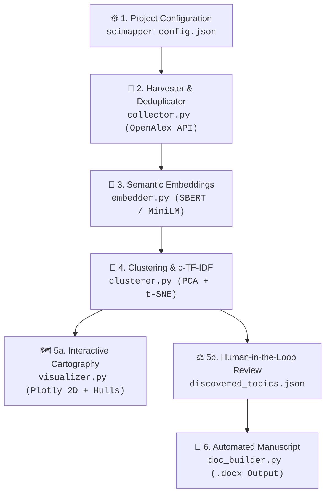

<div align="center">

# 🚀 SciMapper
### Automated Scientific Mapping & Systematic Literature Reviews with Dense Semantic Clustering

[](https://www.python.org/)
[](https://opensource.org/licenses/MIT)
[](https://www.prisma-statement.org/)
[](https://openalex.org/)
[](https://www.sbert.net/)

**An end-to-end, domain-agnostic framework designed to conduct reproducible Systematic Literature Reviews (SLR) and Systematic Mapping Studies (SMS).**  
It automates academic corpus harvesting, deduplication, dense semantic embedding, unsupervised clustering, taxonomic discovery, interactive 2D cartography, and manuscript drafting—while keeping **researchers firmly in the loop**.

🌐 **Languages:** **English** • [Español (Guía en Castellano)](README_ES.md)

[Quickstart](#-quickstart-in-3-steps) • [Architecture](#-framework-architecture) • [Comparison](#-comparison-with-the-state-of-the-art) • [Theoretical Foundation](#-theoretical-foundations) • [Citation](#-citation)

</div>

---

## 🌟 Key Features

* 📡 **Automated Scholarly Harvesting:** Direct connection to the **OpenAlex API** (*Polite Pool* with 250M+ works) executing boolean queries and reconstructing inverted-index abstracts in $O(N \log N)$.
* 🧹 **Bidirectional Deduplication:** Collapses duplicates across arXiv, IEEE, ACM, Springer, and PubMed via canonical lowercase DOI and normalized lexical title hashing.
* 🧠 **Domain-Specific Transformer Presets:** Plug-and-play dense representations via `Sentence-Transformers`:
  * `software_engineering`: `sentence-transformers/all-MiniLM-L6-v2`
  * `biomedical_health`: `microsoft/BiomedNLP-PubMedBERT-base-uncased-abstract`
  * `scientific_general`: `allenai/scibert_scivocab_uncased`
  * `finance_business`: `ProsusAI/finbert`
  * `multilingual`: `sentence-transformers/paraphrase-multilingual-MiniLM-L12-v2`
* 🔬 **Unsupervised Topic Discovery ($c$-TF-IDF):** Discovers latent research themes without generative hallucination, extracting mathematically distinctive n-grams using *Class-based TF-IDF*.
* 🗺️ **Interactive Cartography & Cluster Hulls:** Produces publication-grade 2D HTML dashboards (Plotly) featuring:
  * Regional boundaries via **Convex Hulls** with smoothed spline contours.
  * Cluster centroids with real-time metadata cards ($N$, percentage, top keywords).
  * Layer switching (*Full View*, *Cluster Boundaries Only*, *Paper Scatter Points*).
* 📈 **Temporal Dynamics & Hot Topic Radar:** Computes Compound Annual Growth Rates (CAGR) per cluster to classify topics into 🚀 *Emerging*, ⚖️ *Mature*, or 📉 *Declining*.
* 🛡️ **Mathematical PRISMA 2020 Audit:** Objective isolation of out-of-scope or foreign language clusters as documented exclusion criteria.
* 📝 **Automated Manuscript Generation:** Compiles an executive Microsoft Word (`.docx`) template complete with cover page, research questions (RQs), PRISMA summary tables, taxonomy distribution, and structured discussion sections.

---

## 🏗️ Framework Architecture



---

## ⚡ Quickstart in 3 Steps

### 1. Installation

Clone the repository and install the dependencies:

```bash
git clone https://github.com/gustavoandresfu/SciMapper.git
cd SciMapper
pip install -r requirements.txt
```

*(Optional)* Install as an editable command-line utility:
```bash
pip install -e .
```

---

### 2. Initialize a Project

Launch the interactive configuration wizard (prompts for domain preset, search queries, and project metadata):

```bash
python main.py --init
# Or if installed via pip:
scimapper --init
```
*(Or use `python main.py --init --quick` to generate the baseline template directly without prompts).*

The generated `sms_config.json` is ready to inspect and refine:

```json
{
  "project_metadata": {
    "title": "Systematic Literature Review: Generative AI in Healthcare",
    "short_name": "SciMapper_GenAI_Health",
    "authors": ["Your Name"],
    "temporal_window": [2019, 2026],
    "output_dir": "./output"
  },
  "research_questions": {
    "RQ1": "What foundational architectures and LLMs are predominantly adopted in clinical workflows?",
    "RQ2": "What empirical metrics and validation benchmarks are reported for diagnostic accuracy?",
    "RQ3": "What open challenges regarding hallucinations and ethical safety remain unaddressed?"
  },
  "search_strategy": {
    "openalex_email": "researcher@university.edu",
    "max_results_per_query": 100,
    "queries": [
      "\"generative ai\" AND \"clinical diagnostics\"",
      "\"large language models\" AND \"medical decision support\""
    ]
  },
  "nlp_tuning": {
    "domain_preset": "biomedical_health",
    "n_clusters": 5
  }
}
```

---

### 3. Run the Automated Pipeline

Execute the discovery phase:

```bash
python main.py --run-discovery --config sms_config.json
```

1. Review and refine taxonomic names in `output/discovered_topics.json`.
2. Inspect the pre-selected seminal papers in `output/candidatos_discusion.csv`.
3. Compile the interactive dashboard and Word document:

```bash
python main.py --compile --config sms_config.json
python main.py --build-doc --config sms_config.json
```

Or execute everything end-to-end in a single run:

```bash
python main.py --all --config sms_config.json
```

---

## 📊 Comparison with the State-of-the-Art

| Capability | ASReview | Generic BERTopic | Manual Review Tools (Covidence / Rayyan) | **SciMapper** |
| :--- | :---: | :---: | :---: | :---: |
| **Academic Ingestion** | ❌ Manual (CSV/RIS) | ❌ None | ❌ Manual Import | **✅ Automated OpenAlex API** |
| **Deduplication** | ⚠️ Basic | ❌ None | ⚠️ Exact match | **✅ Canonical DOI + Title Hash** |
| **Semantic Representations** | ✅ Optional | ✅ Native | ❌ None | **✅ Pre-tuned Domain Transformers** |
| **Topic Modeling ($c$-TF-IDF)** | ❌ Binary only | ✅ Yes | ❌ None | **✅ Mathematical $c$-TF-IDF** |
| **Objective PRISMA Exclusion** | ❌ Human judgment | ❌ None | ❌ Human labeling | **✅ Algorithmic Outlier Clustering** |
| **Cartography with Convex Hulls** | ❌ None | ⚠️ Scatter only | ❌ None | **✅ 2D Hulls + Centroids + Density** |
| **Temporal CAGR Tracking** | ❌ None | ❌ Manual | ❌ None | **✅ Automated Hot-Topic Radar** |
| **Automated Manuscript (.docx)** | ❌ None | ❌ None | ❌ Export tables | **✅ Formatted PRISMA Word Paper** |

---

## 🔬 Theoretical Foundations

The framework's methodological and algorithmic foundations are grounded in established literature:

1. **Topic Modeling & Semantic Representation:**  
   Based on the modular architecture described by **Jay Alammar and Maarten Grootendorst** in *Hands-On Large Language Models* (O'Reilly, Chapter 5: *Text Clustering and Topic Modeling*), decoupling dense vector embeddings, dimensionality reduction, clustering, and class-based TF-IDF ($c$-TF-IDF).
2. **Systematic Mapping Methodology:**  
   Follows the seminal guidelines of **Petersen et al. (2008)** (*Systematic Mapping Studies in Software Engineering*) and **Kitchenham & Charters (2007)**.
3. **Auditability & Reporting Standards:**  
   Strict adherence to the **PRISMA 2020** statement (*Preferred Reporting Items for Systematic Reviews and Meta-Analyses*), ensuring transparent and reproducible record accounting.

---

## 📁 Repository Structure

```text
SciMapper/
├── config_template.json    # Master template for project setup
├── test_config.json        # Quick verification test suite
├── main.py                 # Unified CLI orchestrator
├── requirements.txt        # Python dependency specification
├── pyproject.toml          # Standard packaging & CLI entry point (scimapper)
├── CITATION.cff            # Academic citation metadata
├── LICENSE                 # MIT Open Source License
└── core/
    ├── collector.py        # OpenAlex API ingestion & abstract reconstruction
    ├── embedder.py         # Multi-domain Sentence-Transformer pipeline
    ├── clusterer.py        # Dimensionality reduction (PCA+t-SNE) & c-TF-IDF
    ├── selector.py         # Stratified seminal paper recommendation
    ├── visualizer.py       # Plotly 2D interactive maps with Convex Hulls
    └── doc_builder.py      # Automated PRISMA Word manuscript generation
```

---

## 📖 Citation

If you use **SciMapper** in your research, academic reviews, or dissertations, please cite it as:

```bibtex
@software{futo_scimapper_2026,
  author       = {Gustavo Andrés Futo},
  title        = {SciMapper: Automated Scientific Mapping & Systematic Literature Reviews with Dense Semantic Clustering and PRISMA 2020 Compliance},
  year         = {2026},
  publisher    = {GitHub},
  journal      = {GitHub repository},
  howpublished = {\url{https://github.com/gustavoandresfu/SciMapper}}
}
```

---

## 📄 License

This project is licensed under the **MIT License** — see the [LICENSE](LICENSE) file for details.  
Author: **Gustavo Andrés Futo** (2026).
