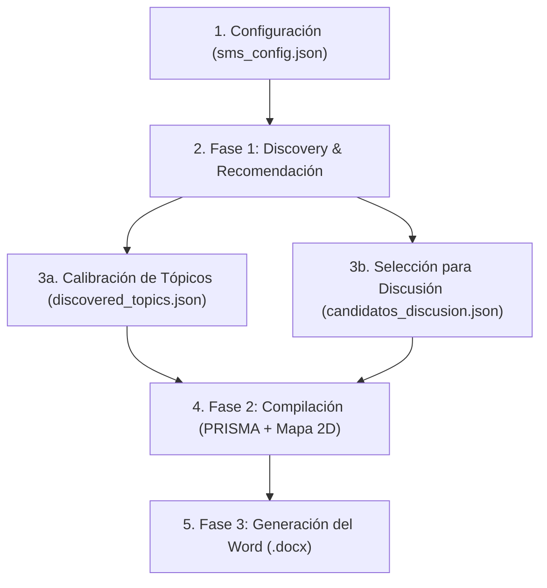

# 🚀 AutoSMS Framework: Pipeline Configurable y Reutilizable para Mapeos Sistemáticos de Literatura

Un framework agnóstico y modular diseñado para ejecutar **Mapeos Sistemáticos de Literatura (SMS)** y **Revisiones Sistemáticas (SLR)** bajo estándares académicos (**PRISMA 2020**), combinando **Machine Learning no supervisado**, **selección estratificada de literatura** y **supervisión humana continua (Human-in-the-Loop)**.

Permite aplicar exactamente la misma metodología rigurosa a **cualquier otra área del conocimiento** (medicina, finanzas, ciberseguridad, robótica, derecho, etc.) sin escribir código adicional y sin alterar los archivos del proyecto previo.

---

## 📁 Estructura del Framework

El framework reside en su propia carpeta aislada (`AutoSMS_Framework/`):

```text
AutoSMS_Framework/
├── config_template.json      <- Plantilla maestra de configuración
├── main.py                   <- Orquestador de línea de comandos (CLI)
├── README_FRAMEWORK.md       <- Este manual de uso
└── core/
    ├── collector.py          <- Ingesta de OpenAlex API, reconstrucción de abstracts y deduplicación
    ├── embedder.py           <- Modelos de lenguaje densos por dominio (Sentence-Transformers)
    ├── clusterer.py          <- Reducción PCA+t-SNE, K-Means y c-TF-IDF léxico
    ├── selector.py           <- Recomendación estratificada de papers clave para la discusión
    ├── doc_builder.py        <- Generador automatizado del borrador académico en Word (.docx)
    └── visualizer.py         <- Generación de mapas Plotly 2D y datasets finales
```

---

## 🛠️ Flujo Metodológico Completo (De la Pregunta al Paper Word)



---

### Paso 1: Inicializar un nuevo proyecto

En tu consola, ejecuta:
```bash
python main.py --init
```
El sistema iniciará un **asistente guiado interactivo** en la consola que te pedirá el título del estudio y te mostrará un **menú numerado (1 a 5) para elegir tu disciplina** (Medicina, Software, Negocios, etc.), configurando automáticamente el modelo de lenguaje correspondiente.

*(Si prefieres generar directamente la plantilla sin preguntas, puedes ejecutar `python main.py --init --quick`).*

#### Ejemplo de archivo `sms_config.json`:
```json
{
  "project_metadata": {
    "title": "Mapeo Sistemático de la Literatura: [Tu Tema]",
    "short_name": "SMS_Proyecto",
    "authors": ["Investigador Principal", "Coautor"],
    "temporal_window": [2019, 2026],
    "output_dir": "./output"
  },
  "research_questions": {
    "RQ1": "¿Cuáles son los enfoques y técnicas principales reportadas en la literatura?",
    "RQ2": "¿Qué métricas empíricas de evaluación se reportan?",
    "RQ3": "¿Cuáles son las limitaciones, desafíos abiertos y vacíos de investigación?"
  },
  "search_strategy": {
    "openalex_email": "tu_email@universidad.edu",
    "max_results_per_query": 100,
    "queries": [
      "\"primary topic\" AND (\"secondary keyword\" OR \"alternative keyword\")",
      "\"methodology keyword\" AND \"domain keyword\""
    ]
  },
  "nlp_tuning": {
    "domain_preset": "software_engineering",
    "n_clusters": 6
  }
}
```

#### 🧭 Guía de Configuración: ¿Para qué sirve cada campo?

| Bloque / Campo | ¿Qué defines aquí? | ¿Qué impacto real tiene en el proceso? |
| :--- | :--- | :--- |
| **`title` y `authors`** | Título de tu estudio y nombres del equipo. | Portada y encabezados formales del documento Word (`.docx`). |
| **`temporal_window`** | Rango de años a estudiar (ej. `[2019, 2026]`). | Filtra las publicaciones y calcula el radar de madurez/crecimiento temporal (CAGR). |
| **`search_strategy.queries`** | Cadenas de búsqueda booleanas (`AND`, `OR`, `""`). | **Es lo que realmente trae los artículos.** Se envían a la API de OpenAlex para recolectar el corpus. |
| **`search_strategy.max_results_per_query`** | Cantidad máxima de papers por cada búsqueda (ej. `100`). | Controla el volumen inicial de literatura a procesar para no sobrecargar la muestra. |
| **`research_questions` (RQs)** | Tus preguntas de investigación en lenguaje natural. | **Estructura editorial y metodológica.** (Ver nota a continuación). |
| **`domain_preset`** | El área del conocimiento (ver catálogo abajo). | Selecciona el modelo de lenguaje de IA (Transformer) óptimo para entender el vocabulario de tu disciplina. |
| **`n_clusters`** | Cantidad de grupos temáticos a descubrir (ej. `5` o `6`). | Divide matemáticamente el corpus en esa cantidad de familias conceptuales. |

> [!NOTE]
> **Sinergia del Framework: Cómo se complementan las Búsquedas y las Preguntas**
> * **Los Términos de Búsqueda (`queries`) — El Motor de Recolección e IA:** Son los encargados de conectar con los repositorios académicos (OpenAlex) para recuperar la literatura relevante. Constituyen la base empírica del estudio: a partir de los títulos y resúmenes recolectados, los modelos de lenguaje (Transformers) y los algoritmos de agrupamiento (K-Means / c-TF-IDF) descubren los patrones temáticos de forma objetiva.
> * **El Tema (`title`) y las Preguntas (`RQs`) — La Brújula Metodológica y Editorial:** Definen el propósito y el marco conceptual de la investigación. Guían al investigador al momento de interpretar los temas descubiertos y estructuran automáticamente el manuscrito formal en Word (`.docx`), integrando la Introducción, los objetivos del estudio y la matriz de análisis cualitativo en la Discusión.

> [!TIP]
> **Fórmula recomendada para los términos de búsqueda (`queries`):**
> * **Comillas dobles para frases exactas:** Usa `"deep learning"` en lugar de `deep learning` suelto.
> * **Cruzar con `AND` en mayúsculas:** Cruza la tecnología con el dominio (ej. `"machine learning" AND "cardiology"`).
> * **Sinónimos con `OR` entre paréntesis:** Ej: `("large language models" OR "llm") AND "code generation"`.
> * **Consultas múltiples y precisas:** Es preferible ingresar 2 o 3 consultas concisas que una sola cadena excesivamente larga.

#### Catálogo de Modelos por Dominio (`domain_preset`):
* `"software_engineering"`: `all-MiniLM-L6-v2` (Ingeniería de Software / CS)
* `"biomedical_health"`: `PubMedBERT` (Salud, Medicina y Biología)
* `"scientific_general"`: `SciBERT` (Ciencias exactas / Naturales)
* `"finance_business"`: `FinBERT` (Economía, Finanzas y Negocios)
* `"multilingual"`: `paraphrase-multilingual-MiniLM` (Español u otros idiomas no ingleses)

---

### Paso 2: Ejecutar Fase 1 (Descubrimiento, Dinámica y Recomendación)

```bash
python main.py --run-discovery --config sms_config.json
```

El pipeline ejecuta automáticamente:
1. **Recolección en OpenAlex** y deduplicación estricta por DOI y hash de títulos.
2. **Generación de Embeddings Densos** normalizados con el modelo elegido.
3. **Reducción PCA + t-SNE** a coordenadas 2D.
4. **Clustering y c-TF-IDF** para identificar grupos temáticos y palabras clave.
5. **Radar de Madurez Temporal y CAGR**: Calcula la Tasa de Crecimiento Anual Compuesta por tópico y los clasifica automáticamente en:
   * 🚀 **Emergente (Hot Topic)**: Fuerte aceleración en el trienio reciente (CAGR > 12%).
   * ⚖️ **Maduro / Consolidado**: Producción académica regular y sostenida.
   * 📉 **En Declive**: Líneas de investigación con baja actividad reciente.
6. **Recomendación Estratificada de Artículos**: Calcula la centralidad semántica respecto al centroide de cada cluster (medoide) ponderada por impacto de citas y filtrada por umbral configurable (`min_citations`), identificando los candidatos óptimos para la discusión cualitativa.

---

### Paso 3: Calibración Humana (Human-in-the-Loop)

En tu carpeta de salida se generan dos archivos para intervención experta:

#### 3a. Ajuste de Taxonomías (`output/discovered_topics.json`):
* Revisa las palabras clave, títulos de muestra y el badge de dinamismo temporal (`temporal_dynamics`).
* Asigna nombres formales a los tópicos en `"assigned_name"`.
* Si un cluster es ruido fuera de alcance, cambia `"exclude_prisma": true` (el sistema lo descartará auditando la cifra en PRISMA).

#### 3b. Selección de Papers para la Discusión (`output/candidatos_discusion.json` o `.csv`):
* El algoritmo preselecciona los artículos más representativos e influyentes de cada categoría, priorizando aquellos con validación bibliométrica (`>= min_citations`).
* Incluye notas automáticas de auditoría (ej: `✔ Validación bibliométrica` vs `⚠️ Sin citas acumuladas por ser publicación reciente`).
* Puedes abrir el `.csv` en Excel o el `.json` en tu editor.
* Marca `"selected_for_deep_review": true` en los 8 a 10 artículos que leerás en profundidad para la discusión cualitativa.

---

### Paso 4: Fase 2 (Compilación de Dashboard Dual y Auditoría PRISMA)

```bash
python main.py --compile --config sms_config.json
```
Genera:
* **`mapa_interactivo.html` (Dashboard Dual de Última Generación)**:
  * **Panel Izquierdo**: Mapa Conceptual 2D de dispersión con botones interactivos para alternar entre:
    * 🌐 *Vista Híbrida* (Puntos + Contornos de Densidad KDE).
    * 📍 *Solo Puntos y Clusters*.
    * 🌊 *Solo Mapa de Densidad Topográfico* (para detectar "valles" o vacíos de investigación).
  * **Panel Derecho**: Gráfico sincronizado de **Líneas Temporales Anuales (2018–2026)** para comparar el crecimiento de cada taxonomía.
* **`corpus_con_topicos.csv`**: Dataset consolidado con coordenadas, nombres de tópicos y métricas de citas.
* **`prisma_summary_report.txt`**: Balance cuantitativo de exclusiones e inclusiones.

---

### Paso 5: Fase 3 (Generación del Borrador Formal en Word)

```bash
python main.py --build-doc --config sms_config.json
```
Compila un archivo `.docx` formal listo para redactar con:
1. **Tipografía Académica Estricta**: Times New Roman 10pt, justificado completo (`w:jc="both"`), interlineado 1.15.
2. **Tablas Estilizadas**: Encabezados en gris `#666666`, texto blanco negrita, filas alternadas en `#F0F4F8`.
3. **Sección I (Introducción)**: Con el llamado formal a tus RQs.
4. **Sección II (Metodología)**: Con la **Tabla PRISMA 2020** calculada con los números exactos de tu corpus.
5. **Sección III (Resultados y Dinámica Temporal)**: Con la **Tabla de Taxonomías**, porcentajes, descriptores c-TF-IDF y la columna de **Estado de Madurez y CAGR (%)**.
6. **Sección IV (Discusión Cualitativa)**:
   * **Matriz de Síntesis**: Tabla comparativa de los artículos que seleccionaste en el Paso 3b.
   * **Subsecciones por Artículo**: Título, autores, revista/conferencia, DOI, abstract y prompts estructurados para registrar los aportes empíricos y limitaciones.
7. **Secciones V y VI**: Amenazas a la validez, conclusiones y referencias bibliográficas.

*(Nota: Si deseas ejecutar las 3 fases de corrido sin detenerte, puedes usar `python main.py --all --config sms_config.json`).*
